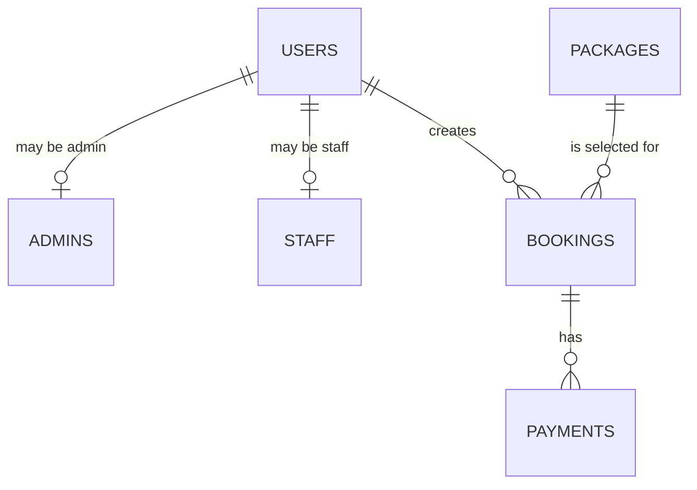

# Catering database relationships

`users.role` identifies an account as a customer, staff member, or admin. The `admins` and `staff` tables hold separate role-specific records for the IM requirement. A single user should not be represented in both role-specific tables; the CLI role tool manages this consistency in this starter.

**Primary keys:** `user_id`, `admin_id`, `staff_id`, `package_id`, `booking_id`, `payment_id`.

**Foreign keys:** `admins.user_id`, `staff.user_id`, `bookings.customer_id`, `bookings.package_id`, `payments.booking_id`.

The `payments` entity is currently a database placeholder; the web form does **not** process money.
